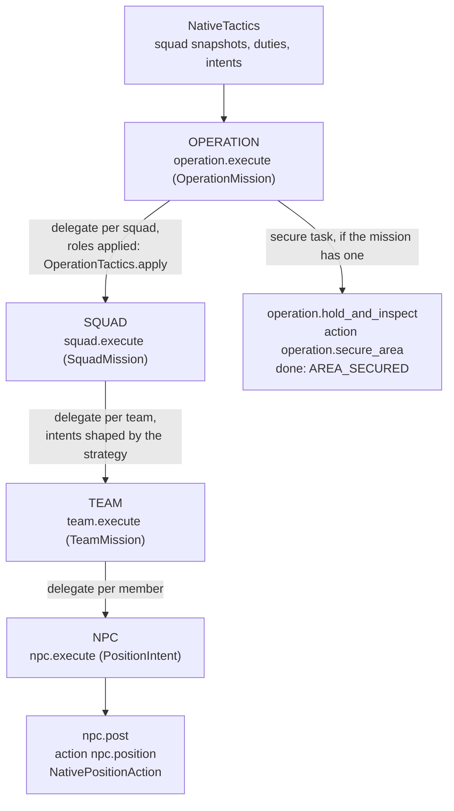
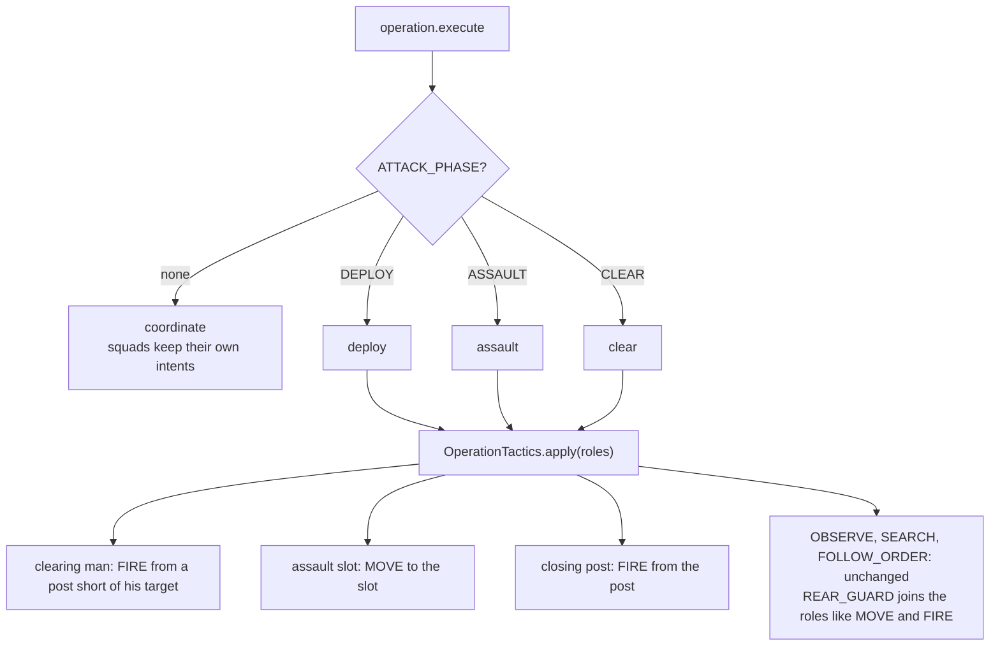
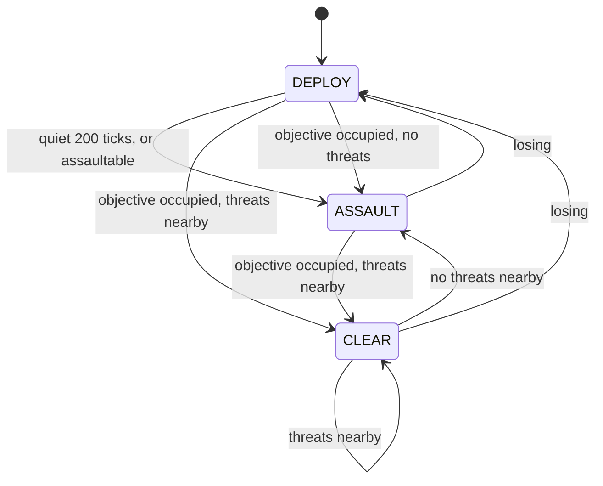
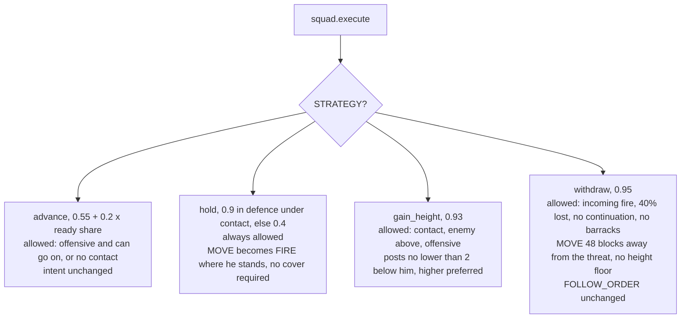
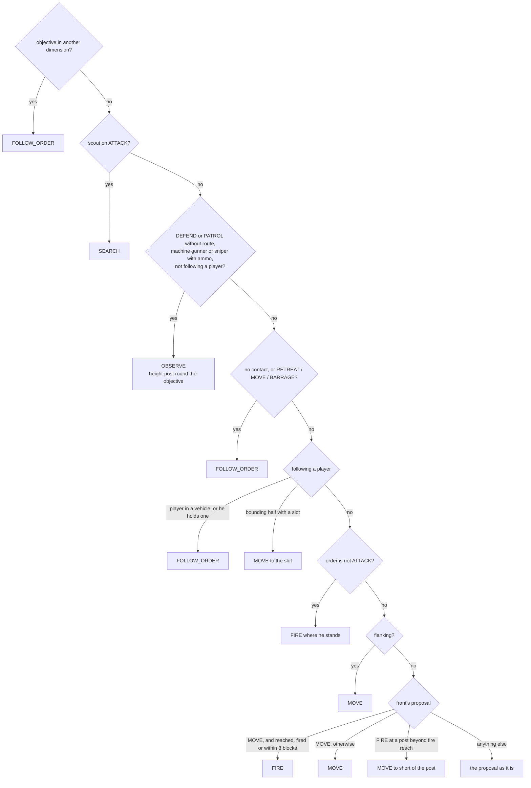
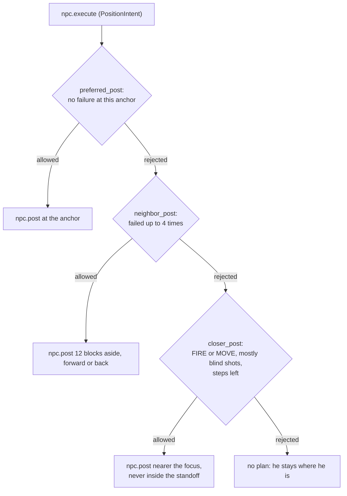

# HTN diagrams

How the tactical HTN in `common/.../ai/tactics` and `ai/integration` is built today, drawn by hand
from the code. It is a map for discussing and planning changes, so keep it in step with the code:
a change to `TacticalDomain`, `OperationTactics.duty`, `SquadStrategy` or `AttackPhase` updates the
diagram it touches in the same PR. The prose around the code is in
[ARCHITECTURE.md](ARCHITECTURE.md#squad-tactics-htn) and [AI-RUNTIME.md](AI-RUNTIME.md).

## Levels

Every level is a planning agent with its own `HtnDomain` (`TacticalDomain.at`). A level hands its
children their tasks through `DelegationTask`; only the NPC level runs a world action.
`NativeTactics` builds the missions from squad snapshots and runs the agents.

## Operation

One method per attack phase, chosen by the `ATTACK_PHASE` fact; with no phase the squads carry out
their own missions.

`AttackPhase.next` moves between the phases. Its first check runs in every phase: with the
objective occupied and the attack not losing, the phase is CLEAR while threats are nearby and
ASSAULT otherwise. Losing means a contact in the last 200 ticks and fewer than 1.5 ready shooters
per enemy at the objective.

## Squad

One method per `CombatStrategy`, chosen by the `STRATEGY` fact. `StrategyEvaluation` scores the
allowed strategies and `DecisionStability` keeps the current one for at least 40 ticks, and after
that until another scores 0.12 higher. The strategy reshapes each member's intent, except an
assaulting or ordered one.

## Member duty

`OperationTactics.duty` picks each member's duty before the plan; the first matching row wins.

## NPC

The NPC domain finds a post for the intent. When the search fails, `NativeTactics` records a
`POST_FAILURE` for the anchor, valid for 200 ticks, and the next plan tries the next method.

`npc.post` runs the `npc.position` action. It holds while the man may move (`MOVABLE`) and, when
cover is required, while he has it (`COVER`); it is done on `ARRIVED`. FOLLOW_ORDER takes no `motion`
resource and never times out; every other duty holds `motion` and times out after 1200 ticks. `NativePositionAction` turns the duty into the job the
position search in `combat/tactics` runs:

| Duty | Job |
|---|---|
| FIRE | ANTI_ARMOUR when he carries a loaded launcher and armour is in sight, otherwise COVER |
| MOVE | ADVANCE |
| SEARCH | SEARCH |
| REAR_GUARD | RESERVE |
| OBSERVE | OVERWATCH with a height floor, otherwise OBSERVE |
| FOLLOW_ORDER | WAIT |
