# HTN task tree

The tactical HTN as the code builds it today, drawn by hand as one task tree that covers every
order and situation. It is a map for discussing and planning changes, so keep it in step with the
code: a change to `TacticalDomain`, `MemberDuties`, `OperationTactics`, `SquadStrategy` or `AttackPhase` updates
this file in the same PR. The prose is in [ARCHITECTURE.md](ARCHITECTURE.md#squad-tactics-htn) and
[AI-RUNTIME.md](AI-RUNTIME.md).

How to read it, left to right:

- a **blue** box is a task or a question that splits into the branches after it;
- a **white** box is one case of the question before it;
- a **green** box is what the man ends up doing;
- a **dark** box is an action that runs in the world.

Branches 1 to 3 decide each man's task; branches 4 and 5 are how his team and he carry it out. In a
fight, branches 2 and 3 can change the task branch 1 gave him. Branch 3 and its approach, and
branch 4, are HTN methods chosen by utility; branch 5 chooses by order and preconditions.

```mermaid
flowchart LR
    classDef task fill:#dbe8ff,stroke:#4a6fa5,color:#000
    classDef case fill:#ffffff,stroke:#888,color:#000
    classDef duty fill:#d9f2d9,stroke:#3c8c3c,color:#000
    classDef action fill:#333,stroke:#333,color:#fff

    ROOT(["Squad has an order"]):::task
    ROOT --> T1(["1. What each man does"]):::task
    ROOT --> T2(["2. In an attack: the operation's phase"]):::task
    ROOT --> T3(["3. Under fire: the squad's strategy"]):::task
    ROOT --> T4(["4. How his team rushes"]):::task
    ROOT --> T5(["5. Carrying out his task"]):::task

    %% 1. Each man's task by order (OperationTactics.duty)
    T1 --> ELSE["objective in another dimension"]:::case --> D_FO0["follow the order"]:::duty
    T1 --> O_MOVE["MOVE, RETREAT, BARRAGE"]:::case --> D_FO1["follow the order:<br/>march to the objective"]:::duty

    T1 --> O_ATT(["ATTACK"]):::task
    O_ATT --> A_SC["scout"]:::case --> D_SE["search the point to inspect"]:::duty
    O_ATT --> A_NC["no contact"]:::case --> D_FO2["follow the order:<br/>march to the objective"]:::duty
    O_ATT --> A_C(["in contact: the front's proposal"]):::task
    A_C --> A_FL["flanking round the objective<br/>(squad's approach: flank)"]:::case --> D_MV1["move to the next waypoint"]:::duty
    A_C --> A_MV["front says move"]:::case
    A_MV --> A_MV1["there, already fired,<br/>or within 8 blocks"]:::case --> D_FI1["fire where he stands"]:::duty
    A_MV --> A_MV2["otherwise"]:::case --> D_MV2["move to his front slot"]:::duty
    A_C --> A_FI["front says fire"]:::case
    A_FI --> A_FI1["post beyond reach"]:::case --> D_MV3["move to short of the post"]:::duty
    A_FI --> A_FI2["post in reach"]:::case --> D_FI2["fire from the post"]:::duty
    A_C --> A_RG["front says rear guard"]:::case --> D_RG["rear guard"]:::duty

    T1 --> O_DEF(["DEFEND, or PATROL without a route"]):::task
    O_DEF --> F_SEN["machine gunner or sniper<br/>with ammo, not following a player,<br/>arrived at the objective or already on its post"]:::case --> D_OB["observe from a height post<br/>round the objective"]:::duty
    O_DEF --> F_NC["anyone else, no contact"]:::case --> D_FO3["follow the order:<br/>go to and hold the objective"]:::duty
    O_DEF --> F_C["anyone else, in contact"]:::case --> D_FI3["fire where he stands"]:::duty

    T1 --> O_PAT(["PATROL with a route"]):::task
    O_PAT --> P_NC["no contact"]:::case --> D_FO4["follow the order:<br/>walk the route"]:::duty
    O_PAT --> P_C["in contact"]:::case --> D_FI4["fire where he stands"]:::duty

    T1 --> O_FOL(["FOLLOW a player"]):::task
    O_FOL --> W_NC["no contact"]:::case --> D_FO5["follow the order:<br/>keep his place by the player"]:::duty
    O_FOL --> W_V["in contact, player in a vehicle<br/>or he holds one"]:::case --> D_FO6["follow the order:<br/>the ride sees to it"]:::duty
    O_FOL --> W_B["in contact, his half runs this beat"]:::case --> D_MV4["move to his place by the player"]:::duty
    O_FOL --> W_F["in contact, his half covers"]:::case --> D_FI5["fire where he stands"]:::duty

    %% 2. Operation (TacticalDomain.operation, AttackPhase, OperationTactics.apply)
    T2 --> PH_N["no attack"]:::case --> D_OWN["every squad keeps its own tasks"]:::duty
    T2 --> PH_D["DEPLOY: too few to assault yet"]:::case --> D_LINE["tasks from branch 1:<br/>the front's firing line"]:::duty
    T2 --> PH_A(["ASSAULT: enough shooters,<br/>or quiet for 200 ticks"]):::task
    PH_A --> PH_A1["defenders still on the objective"]:::case --> D_CLOSE["movers fire from posts<br/>half as far from the defenders"]:::duty
    PH_A --> PH_A2["nobody left on it"]:::case --> D_RING["movers take a loose ring<br/>on the objective"]:::duty
    T2 --> PH_C(["CLEAR: objective taken,<br/>enemies still round it"]):::task
    PH_C --> PH_C1["2 to 4 ready men nearest them"]:::case --> D_CLR["fire at the nearest enemy<br/>from a post short of him"]:::duty
    PH_C --> PH_C2["the other movers"]:::case --> D_RING2["hold the ring on the objective"]:::duty
    T2 --> PH_H["area to hold"]:::case --> SEC["hold the area and inspect it"]:::action
    T2 --> PH_K["observers, scouts, men following the order"]:::case --> D_KEEP["keep their own task"]:::duty

    %% 3. Squad strategy (TacticalDomain.squad, SquadStrategy)
    T3 --> S_A["advance: attacking and able to go on,<br/>or no contact"]:::case --> D_SA["tasks unchanged"]:::duty
    T3 --> S_H["hold: defending under contact"]:::case --> D_SH["a move becomes fire where he stands"]:::duty
    T3 --> S_G["gain height: attacking an enemy above"]:::case --> D_SG["posts no lower than 2 below him,<br/>higher preferred"]:::duty
    T3 --> S_W["withdraw: incoming fire, 40% lost,<br/>no way to go on, no barracks"]:::case --> D_SW["fall back 48 blocks from the threat"]:::duty
    T3 --> S_B["bound by halves: attacking, able to go on,<br/>no enemy above, not scattered, 4+ movers"]:::case --> D_SB["one half of the movers rushes by legs,<br/>covered by the other's fire, not by shelter;<br/>the other fires from its posts;<br/>swap when each runner did a leg"]:::duty
    T3 --> S_R["regroup: attacking, not flanking, 4+ men,<br/>a third of them and 2+ scattered"]:::case --> D_SR["move to a rally point 12 blocks behind<br/>until all are back near the squad, 20 s at most;<br/>not again for 30 s"]:::duty
    T3 --> S_K["assault men, men moving for their order,<br/>men following the order"]:::case --> D_SK["keep their task"]:::duty
    T3 --> S_AP(["then its approach,<br/>for a squad attacking alone"]):::task
    S_AP --> S_AF["flank: a manoeuvre group can split off,<br/>the squad not scattered or regrouping,<br/>the flank not found blocked lately"]:::case --> D_AF["next layout splits off the<br/>manoeuvre group round the arc"]:::duty
    S_AP --> S_AR["frontal"]:::case --> D_AR["the whole squad comes on together"]:::duty

    %% 4. Team (TacticalDomain.team, TeamRushes)
    T4 --> R_T["together"]:::case --> D_RT["each mover rushes when his leg is done"]:::duty
    T4 --> R_P["in pairs: 2+ movers nobody covers yet,<br/>under fire, 12+ blocks to go"]:::case --> D_RP["each rush waits for the partner's fire"]:::duty

    %% 5. Position (TacticalDomain.npc, NativePositionAction)
    T5 --> N0["a mover in a fight, not in an assault"]:::case --> LEG["once covered, rush to the next post on the way,<br/>fire from it, then the next leg"]:::action
    T5 --> N1["first try: at his anchor"]:::case
    T5 --> N2["failed there: 12 blocks aside,<br/>forward or back, up to 4 times"]:::case
    T5 --> N3["still failing and his shots blocked:<br/>closer to the enemy, never inside his standoff"]:::case
    T5 --> N4["nothing left"]:::case --> D_STAY["his order and gun move him<br/>until the failures are forgotten"]:::duty
    N1 & N2 & N3 --> POS["go to the post and hold it"]:::action
```

## Details the tree leaves out

**Attack phase** (`AttackPhase.next`). Checked first in every phase: with the objective occupied
and the attack not losing, the phase is CLEAR while enemies are near the objective and ASSAULT
otherwise. Losing means a contact within 200 ticks and fewer than 1.5 ready shooters per enemy at
the objective; it sends ASSAULT and CLEAR back to DEPLOY.

**Squad strategy** (`SquadStrategy`, `SquadManners`). One squad method per strategy: every allowed
one gets a score and the best wins. The strategy held scores 0.12 more and, while still allowed,
is the only one allowed for 40 ticks after it was chosen.

| Strategy | Score |
|---|---|
| withdraw | 0.95 |
| gain height | 0.93 |
| hold | 0.9 defending under contact, otherwise 0.4 |
| regroup | 0.9 |
| bound by halves | 0.62 + 0.3 × share of ready shooters when a man was hit in the last 13 s, otherwise 0.3 + 0.3 × that share |
| advance | 0.55 + 0.2 × share of ready shooters |

**Approach** (`SquadApproaches`). A flank scores 0.5 + 0.3 × share of ready shooters, less 2 × the
losses beyond 30%; frontal scores 0.45. The approach held scores 0.12 more. A flank is closed for
600 ticks once half of the men on the arc failed three post searches in a row there.

**Team rush** (`TeamRushes`). Together scores 0.55; pairs score the weighted mean of 0.2, the
share of movers under fire (weight 1) and their distance to go over 32 blocks (weight 0.5). A
covered rush starts once one of the men covering it fired in the last 2 s, none of them has a
target, or 3 s after his last leg. The fire from a leg's post ends once he has fired, his target is
out of his sight, or after 3 s.

**Position** (`npc.post`). It runs while the man may move and, when cover is required, while he
has it; it ends when he arrives. A failed search is remembered for 200 ticks, and that is what moves
him on to the next try. Following the order never times out and leaves his movement to the order
itself; the last-resort hold leaves it to his order and gun too; every other task takes over his
movement. Every task but following the order gives up after 1200 ticks. The task decides
what the position search looks for:

| Task | Search |
|---|---|
| fire | anti-armour post when he has a loaded launcher and armour is in sight, otherwise cover |
| move | advance; a mover in a fight ends each leg on the next post on the way and fires from it (until he has fired, at most 3 s) before the next rush |
| search | search |
| rear guard | reserve |
| observe | height post when he has a height floor, otherwise observe |
| follow the order | wait |
